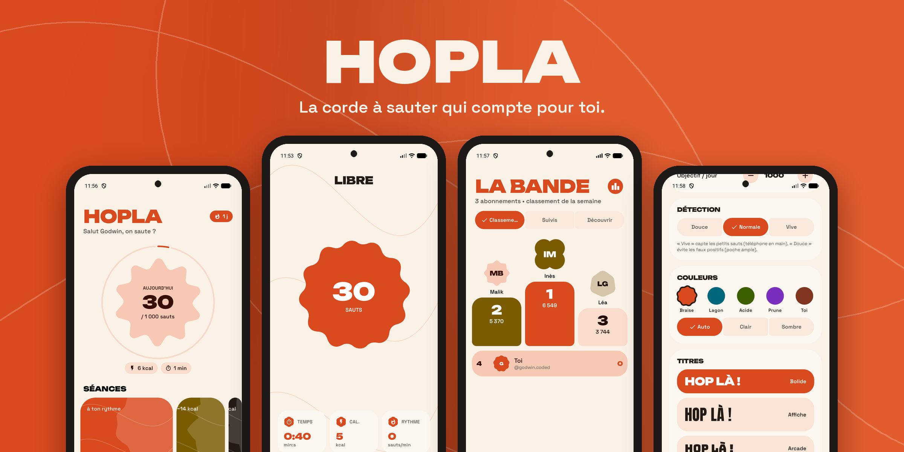

<div align="center">

# HOPLA

**La corde à sauter qui compte pour toi.**

Glisse ton téléphone dans ta poche, saute : Hopla compte chaque saut, chronomètre la séance,
estime tes calories et te mesure à ta bande.

[](https://github.com/OWNER/hopla/releases/latest)


[](LICENSE)



</div>

## Télécharger

1. Télécharge `hopla-1.0.0.apk` depuis la [dernière release](https://github.com/Godark14/hopla/releases/latest).
2. Ouvre le fichier sur ton téléphone et autorise l'installation depuis cette source si Android le demande.

Android 8.0 ou plus récent, avec accéléromètre (c'est le cas de quasiment tous les téléphones).

## Ce que fait Hopla

- 🪢 **Comptage automatique des sauts** par l'accéléromètre, téléphone en poche, en brassard ou en main.
- 🔒 **Écran verrouillé ?** Le comptage continue, le compteur reste dans la notification, et le
  téléphone vibre tous les 100 sauts.
- ⏱️ **Quatre modes** : Libre, Chrono, Objectif de sauts, Tabata.
- 🔥 **Calories** estimées selon ton rythme et ton poids.
- 📊 **Stats** : objectif du jour, série de jours, semaine comparée à la précédente, record.
- 👯 **La bande** : suis tes amis, classement de la semaine avec podium, défi 1 minute.
- 🎨 **Ton style** : 4 palettes, mode sombre, et 4 thèmes de titres (Bolide, Affiche, Arcade, Élastique).

## Sous le capot

| | |
|---|---|
| Langage & UI | Kotlin, Jetpack Compose, **Material 3 Expressive** (formes animées, ressorts, barre flottante) |
| Capteur | Accéléromètre ~100 Hz, détection de pics à seuil adaptatif ([détails](docs/TECHNIQUE.md#détection-des-sauts)) |
| Arrière-plan | Service de premier plan `health` + wake lock ([détails](docs/TECHNIQUE.md#comptage-écran-éteint)) |
| Backend | [Supabase](https://supabase.com) : connexion par code e-mail, Postgres avec sécurité par ligne (RLS) |
| Hors ligne | Séances enregistrées sur le téléphone puis synchronisées, rien n'est perdu |

## Compiler depuis les sources

1. Clone le dépôt et ouvre-le dans une version récente d'Android Studio (SDK **37.1** installé).
2. Lance l'app sur un **vrai téléphone** : l'émulateur ne simule pas les sauts.

Sans configuration, l'app démarre en **mode démo** avec des amis simulés. Pour le vrai partage,
branche ton propre projet Supabase en 5 minutes : [docs/SUPABASE.md](docs/SUPABASE.md).

```bash
./gradlew test            # tests du détecteur de sauts
./gradlew assembleDebug   # APK de debug
```

## Documentation

- [Configurer Supabase](docs/SUPABASE.md) : base de données, e-mails, clés
- [Fonctionnement technique](docs/TECHNIQUE.md) : détection, écran éteint, architecture
- [Publier une release](docs/RELEASING.md)
- [Historique des versions](CHANGELOG.md)

## Feuille de route

- [ ] Version iOS (Kotlin Multiplatform, navigation Liquid Glass)
- [ ] Défis en direct entre amis
- [ ] Calibration de la détection au premier lancement
- [ ] Widget d'écran d'accueil

## Contribuer

Les issues et pull requests sont bienvenues. Pour un changement important, ouvre d'abord une
issue pour en discuter.

## Licence

Code sous licence [MIT](LICENSE). Polices sous SIL Open Font License 1.1 (Unbounded, Anton,
Bungee, Bricolage Grotesque, Space Grotesk) : textes complets dans [`licenses/`](licenses).
